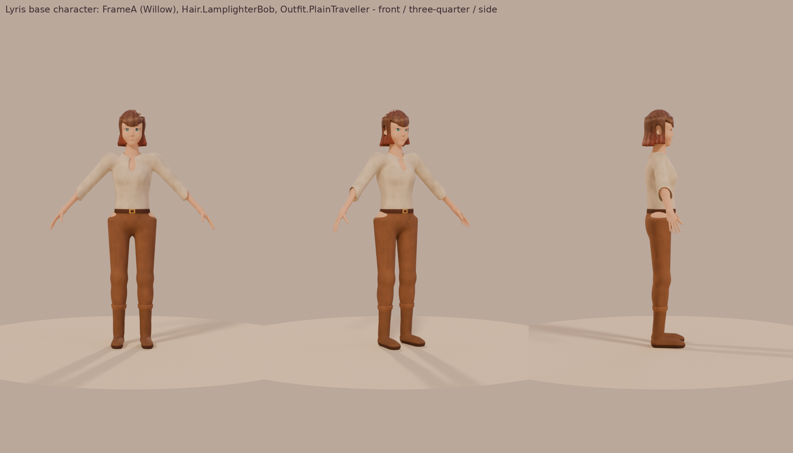

# Lyris base character (T25)

The stylized base character for the character creator, generated by `make_character.py`
(Blender's Python module, `pip install bpy` for Python 3.13). Spec:
`design/character_creator.md`. Slider to morph mapping: `morph_targets.md`. The numbers for
every mesh (triangles, morphs, bones) are in `character_meta.json`.



| Preview | Shows |
|---|---|
| `preview.png` (+ `preview_front/threequarter/side.png`) | FrameA, Lamplighter bob, Plain traveller outfit |
| `preview_frames.png` | both frames, the three hairstyles, four skin swatches across the Peoples |
| `preview_bodies.png` | the bare base bodies, FrameA and FrameB, front and side |
| `preview_face.png`, `preview_peoples.png` | face close-ups: Human, Moonlit elf, Deepkin |
| `preview_morphs.png` | ten face sliders at -1 / 0 / +1 |
| `preview_ears.png` | ear morphs: round, tip, elf point, droop, point angle, Deepkin fin |

## What is in here

Every mesh is a separate skinned mesh on **the same skeleton** (`SK_LyrisBase`):

| File | Mesh | Triangles |
|---|---|---|
| `SKM_Lyris_Body_FrameA.glb` | Willow body, neck down | ~17,000 |
| `SKM_Lyris_Body_FrameB.glb` | Oak body, neck down | ~17,000 |
| `SKM_Lyris_Head.glb` | shared head; section 0 face, section 1 ears | ~12,000 (9.5k face + 2.5k ears) |
| `SKM_Lyris_Eyes.glb` | two eyeballs (they sit in real sockets) | 2,016 |
| `SKM_Lyris_Brows.glb`, `SKM_Lyris_Lashes.glb` | alpha cards | 352, 192 |
| `SKM_Lyris_Hair_LamplighterBob.glb`, `_FallingWater`, `_RopeBraid` | starter hair (`Hair.LamplighterBob`, `Hair.FallingWater`, `Hair.RopeBraid`) | ~7,000 each |
| `SKM_Lyris_Hair_*_LongEar.glb` | the same styles with room for elf and Deepkin points | ~7,000 each |
| `SKM_Lyris_Outfit_PlainTraveller_FrameA/B.glb` | `Outfit.PlainTraveller`: shirt, trousers, belt, boots | ~11,000 |
| `fbx/*.fbx` | the same meshes as FBX | |
| `textures/` | painted textures (below) | |

Body plus head is about 29,000 triangles (budget 30k). The body is complete under the outfit;
hide the covered parts with a material mask later if overdraw matters.

**Skeleton.** UE5 mannequin names and hierarchy: `root`, `pelvis`, `spine_01`..`spine_05`,
`neck_01`, `neck_02`, `head`, `clavicle_l/r`, `upperarm_l/r`, `lowerarm_l/r`, `hand_l/r` with
`thumb_01..03`, `index/middle/ring/pinky_metacarpal` and `_01..03` on each hand, `thigh_l/r`,
`calf_l/r`, `foot_l/r`, `ball_l/r`, plus the mannequin's `ik_foot_root`, `ik_foot_l/r`,
`ik_hand_root`, `ik_hand_gun`, `ik_hand_l/r` helpers (no skin weights). 71 bones. A-pose with
the arms about 45 degrees down, like the mannequin.

**Units and facing.** Centimetres, Z up, feet at Z = 0, character 172 cm tall (6.9 heads).
In the asset it **faces +Y with its left on +X, the same as `SKM_Manny`**. That is why the
template's `BP_ThirdPersonCharacter` mesh component has a -90 yaw: give this mesh the same
-90 yaw and the pawn faces +X.

**Bone orientations differ from the mannequin's.** The bones have the right names, places and
parents, but their local axes come from Blender (each bone's Y runs along it), not the
mannequin's (X along the bone). So **do not** pick `SK_Mannequin` as the skeleton on import.
Import with its own skeleton and retarget (below). That is the reliable route and keeps the
mannequin untouched.

## Importing into Unreal 5.8 (Interchange, glTF)

1. Make a folder, e.g. `/Game/Lyris/Characters/Base/`. Drag in `SKM_Lyris_Body_FrameA.glb`
   first.
2. In the Interchange import dialog:
   - **Skeletal Meshes**: on. **Import Morph Targets**: on. **Import Normals**: Import
     Normals (the meshes carry their own smooth normals). **Recompute tangents** is fine.
   - **Skeleton**: leave empty for this first mesh. A new skeleton is created; rename it
     `SK_LyrisBase`.
   - **Create Physics Asset**: on for the body, off for the rest.
   - **Materials**: Interchange makes simple materials from the glb. Keep them as
     placeholders; the appearance material (T23) replaces them.
   - **Textures**: none are embedded. Import `textures/*.png` separately (see below).
   - Uniform scale 1.0. glTF is in metres and Interchange converts it to centimetres.
3. Import every other `.glb` the same way, but set **Skeleton** to `SK_LyrisBase`. They all
   share it, so they can follow the body with Leader Pose.
4. FBX instead: same settings with the classic FBX importer (Import Morph Targets on,
   skeleton `SK_LyrisBase` after the first). The Blender `Armature` node is dropped by
   Unreal's FBX importer.

**Animations.** To use the template's mannequin animations, make an **IK Rig** for
`SK_LyrisBase` (Auto Create Retarget Chains finds the mannequin names), then an **IK
Retargeter** from `IK_Mannequin` to it. The A-pose is close to the mannequin's, so the default
retarget pose needs little or no tweaking. Export the retargeted animations, or drive the
character at runtime with a Retarget Pose From Mesh node.

**Textures** (`textures/`):

| Texture | Use |
|---|---|
| `T_Head_BaseColor`, `T_Body_FrameA/B_BaseColor`, `T_Ears_BaseColor` | neutral, lightly warm skin (F4E8DE with soft painted shading). **Multiply by the `SkinTone` param.** sRGB |
| `T_Head_Masks`, `T_Body_*_Masks`, `T_Ears_Masks` | R rosiness, G freckles (`Freckles.SunKissed`), B lips, A blush (`Blush.Apples`). Linear (turn sRGB off) |
| `T_Head_Preview` | the head with rosiness painted in, for review |
| `T_Eyes_BaseColor`, `T_Eyes_Masks` | eye preview (Sea iris) and R iris, G pupil, B catchlight, A iris detail grey. Tint the iris by `IrisColorL/R` and the white by `ScleraColor`. Linear for the masks |
| `T_Brows_Natural`, `T_Lashes_Natural` | alpha cards (`Brows.Natural`, `Lashes.Natural`), RGB is a grey to multiply by the brow / hair colour |
| `T_Hair_*_Masks` | R strand detail, G root-to-tip gradient (for `Hair.GradientStart/Softness`), B shine band (`Hair.Shine`), A highlight streaks (`Hair.HighlightAmount`). Linear |
| `T_Hair_*_BaseColor` | a preview colouring of each style |
| `T_Outfit_PlainTraveller_*_BaseColor` / `_Masks` | the outfit in Oat, Wood, DarkWood and Brass; masks R main cloth (`ClothPrimary`), G second cloth (`ClothSecondary`), B trim/metal (`ClothTrim`), A leather |

## Ears and Peoples

Ears are **morphs**, not separate parts: section 1 of the head mesh, a parametric ear whose
shape morphs share one topology. Humans use the round default (or `Ear_Tip`), Moonlit elves
`Ear_Point` with `Ear_PointAngle` and `Ear_Droop`, Deepkin `Ear_Point` plus `Ear_Fin`. Long-ear
Peoples wear the `_LongEar` hair variants (spec 4.2: "mesh variant chosen automatically"),
which leave a slot for the point.

## Hookup is done by other lanes

- **T23 (Player)**: swap the template mannequin for these meshes in the appearance component,
  drive the morphs by name (`morph_targets.md`; set each morph on every mesh that has it, Leader
  Pose does not forward morph weights), and keep the body sliders that are bones as bones.
- **T26 (Lead)**: the new-player start uses whatever T23 builds.
- **Environment (later)**: the T23 appearance material (skin tint, masks, iris, hair gradient)
  can be generated by the Harbor build script once the parameter names are fixed.

## Regenerating

```
pip install bpy --break-system-packages      # Blender 5.2 as a Python module (Python 3.13)
python3 make_character.py                    # about 15 minutes on 2 cores
python3 make_character.py --fast             # coarse quick look, a few minutes
```

Files: `char_rig.py` (skeleton), `char_sdf.py` (distance fields and marching cubes),
`char_shapes.py` (the forms: frames, head, ears, outfit, hair), `char_morphs.py` (every morph,
as a warp of space), `char_paint.py` (painted textures), `char_preview.py` (Cycles previews).

## What still needs an artist's hand

This is a scripted base, good enough to wire the creator and judge proportions. Before players
see it up close:

- **Topology.** Marching cubes plus decimation gives even triangles, not animation edge loops.
  Elbows, knees, shoulders and the mouth corners will crease less cleanly than a hand-made
  mesh. A retopology pass (quads, loops round the eyes and mouth) is the biggest win.
- **Skin weights** are distance-based. They are smooth and need painting on shoulders, hips
  and fingers before extreme poses.
- **No mouth interior or eyelids that close.** The lips are sculpted shut, and blinks and
  expressions need lid and jaw shapes (spec 9.6) that are not here yet.
- **Hair** is a solid painted mass with modelled locks, which suits the style, but it has no
  cards or physics, and the fringe edges are a bit jagged at close range.
- **Hands** are simple. Fingers are separate, but there are no nails (so `Body.NailLength`
  has no morph).
- **Textures** are procedural paint. A painter should do the face, lips and the hair's shine
  ribbon by hand.
- Only one outfit and three hairstyles of the spec's 8 and 27.
