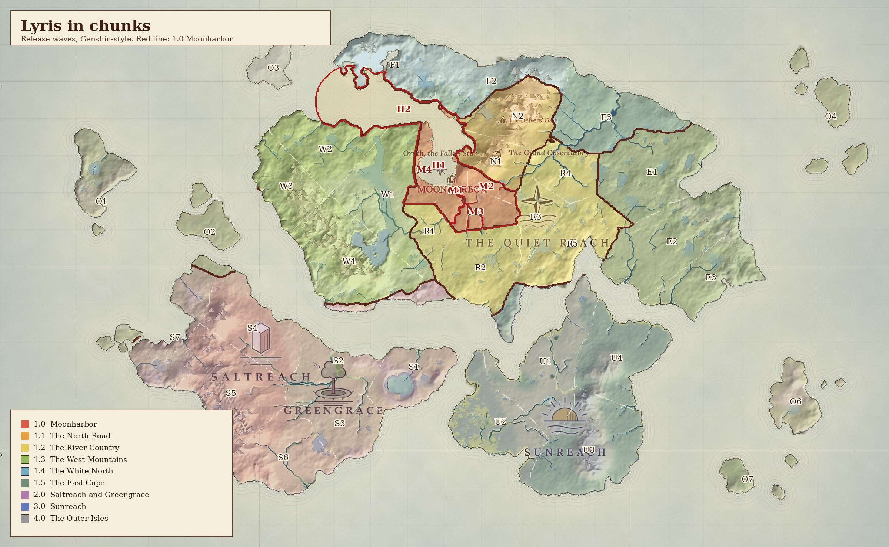
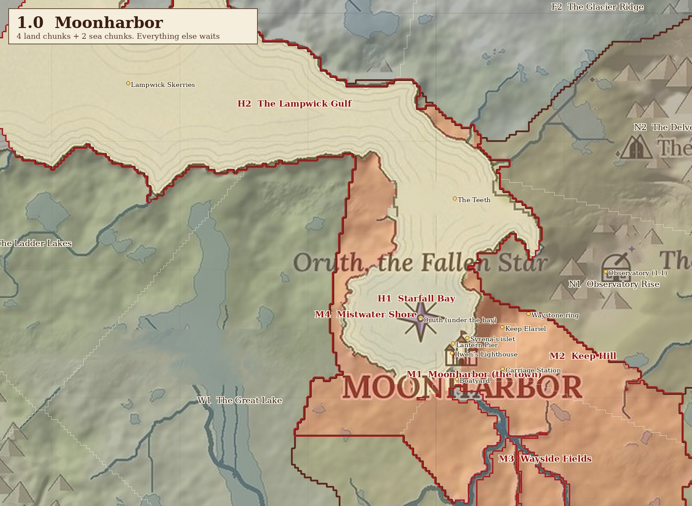

# T53: Lyris in chunks (start small: Moonharbor first)

The user's call (2026-10-22): **start small, with Moonharbor only**, and split the rest of the map into chunks that
open over time, like Genshin did at launch. Genshin launched with only two nations (Mondstadt and Liyue), each cut into a
handful of named subareas. The rest of Teyvat was off the map until later updates: Dragonspine in 1.2, then Inazuma in
2.0. Lyris works the same way, but here each wave is a slice of the real map.

## 1. How the map is cut

Three levels, as in Genshin:

| Level | Lyris | Genshin equivalent |
|---|---|---|
| **Region** | Quiet Reach, Greengrace, Saltreach, Sunreach, the Outer Isles | A nation (Mondstadt, Liyue) |
| **Wave** | A group of chunks that opens together (1.0, 1.1, ... 2.0) | A version update that opens new map |
| **Chunk** | One named subarea, about 1 to 6 km² of land; the unit we build, test and ship | A subarea (Starfell Valley, Windwail Highland) |

The borders follow the server's 20 regions (`Art/World/atlas/regions.png`), cut into subareas around their landmarks.
Moonharbor's chunks are kept small on purpose: no 1.0 land is more than 2 km from the town square. The town itself is the
exact town box from `design/world_map.md`.

**Chunk names are working names. All of them need the user's OK, except where they reuse a canon or wonder name.**

## 2. 1.0 Moonharbor (the first release)

About **3.4 km² of land and 5.3 km² of sea**. Everything a first release needs is inside it: town, harbour, the boat, the
first lamps, farming and gathering ground, and a reason to sail.

| ID | Chunk | Size | What is in it | What it is for |
|---|---|---|---|---|
| **M1** | **Moonharbor (the town)** | 0.17 km² | Market Square and Moonwell, Main Street, Moonmarket, Grand Library, Miners' Guild, Carriage Station, Boatyard, Seawall Stair, Ilwen's Lighthouse, Lantern Pier and the dock lamp | Hub: shops, NPCs, the quay where the boat docks, spawn |
| **M2** | **Keep Hill** | 0.64 km² | Keep Elariel and the Moon Window, the Keep Road, the first waystone ring | Climb and view: the first "go up there" goal, looking out over the bay |
| **M3** | **Wayside Fields** | 1.73 km² | Farmland and meadows along the river branch south of town | Farming plots, gathering, the calm home ground (T12, T13) |
| **M4** | **Mistwater Shore** | 0.87 km² | The bay's west shore, the Old Coast Road and the Mistwater Bridge | Foraging along the coast, a walk out of town; it borders the Great Lake (1.3) |
| **H1** | **Starfall Bay** (sea) | 1.0 km² | The calm bay, Syrena's statue islet and the Hung Star, Oruth's dome deep below | Learning to sail in calm, lamp-lit water (T17 home calm zone) |
| **H2** | **The Lampwick Gulf** (sea) | 4.3 km² | The Teeth reef, the Lampwick Skerries (island chain A) | The first real voyage (about 7 minutes) and the first lamps to relight. Rougher water at the reef tests the hull (T21) |

**Left out of 1.0 on purpose:** the Grand Observatory and the Academy (1.1, the first big update), the Delvers' Gate and
the Hollowdeep, and everything south and west of the 2 km line.

## 3. Release waves

| Wave | Name | Chunks | Land | What it adds |
|---|---|---|---|---|
| **1.0** | **Moonharbor** | M1 to M4, H1, H2 | 3.4 km² (+ 5.3 km² sea) | Town, bay, keep, fields, the gulf and the Lampwick Skerries |
| 1.1 | The North Road | N1 Observatory Rise, N2 The Delvers' Uplands | 5.2 km² | The Grand Observatory and the Academy, the North Road and its lanterns, the Delvers' Gate (entrance only) |
| 1.2 | The River Country | R1 Hollowmere and the Herring Road, R2 The Strait Shore, R3 The Heartland, R4 Glowmere, R5 The Steaming Fields | 13.2 km² | Heart of the Reach, the river, the burned village, the strait coast |
| 1.3 | The West Mountains | W1 The Great Lake, W2 The Ladder Lakes, W3 The Mistwall Coast, W4 The Grey Peaks | 17.0 km² | The lake, Veil Falls, the Mistwall Cliffs, the Under-Halls |
| 1.4 | The White North | F1 The Sisterfjord, F2 The Glacier Ridge, F3 Skyshoals | 11.1 km² | Snow and ice (this wave plays the role Dragonspine did): Frozen Cascade, Rimeglass Caves, the Bellstack |
| 1.5 | The East Cape | E1 Elderheart, E2 The High Table, E3 The Long Door Cape | 14.7 km² | Completes the Quiet Reach |
| **2.0** | **Saltreach and Greengrace** | S1 to S7 | 25.6 km² | The second nation: the Crater Lake, Starglass Spires, Glass Dunes, Skyfall Scar, Hexstone Causeway |
| **3.0** | **Sunreach** | U1 to U4 | 18.1 km² | The third nation: plains, Thunder Curtain, Leviathan's Rest, the Sunstair Volcano, the Lantern Isles and the Blue Eye |
| 4.0 | The Outer Isles | O1 to O8 | 10.0 km² | The islands already on the map |

**New island chains A to H** (approved 2026-10-20) are added by the bake, not by the atlas, so they are not drawn on these
maps. Each one joins the wave of the waters it sits in:
- **A** Lampwick Skerries: 1.0, inside H2.
- **F** Rime Skerries and **B** Hushed Isles: with 1.4.
- **C** Wickstones: with 3.0.
- **D** Tallow Banks: with 1.5.
- **E** Southing Stones, **G** Unremembered Isles and **H** Ember Isle: the far deep, after 4.0.

All chunks: `world_chunks/chunks.json` (id, name, region, wave, size, centre, bounds).

## 4. What a locked chunk looks like (proposal, needs the user's OK)

Genshin closes off unreleased map with invisible walls and an "unexplored" sea. Lyris has a better fit in its own
lore: **the Forgetting Sea**. Where no light is kept, the world is being forgotten. A locked chunk can simply be
*not yet remembered*:
- **On the chart:** it shows as blank parchment with a faint outline.
- **At sea:** past the 1.0 waters the fog thickens and the wind turns the boat gently back ("The charts end here"). The
  player is never pushed hard and nothing is lost.
- **On land:** natural barriers mark the edge (steep ground, deep forest, a closed gate on the North Road), plus a soft
  turn-back at the very edge.
- **When a wave opens:** its chunks are *remembered* for everyone at once. That is the Forgetting Sea's shared-milestone
  idea from the 2026-10-20 decision.

T54 builds this edge for 1.0 once the borders are approved.

## 5. Files

| File | What |
|---|---|
| `world_chunks/chunks.json` | Every chunk: id, name, region, wave, land or water km², centre and bounds (MC block X, Z) |
| `world_chunks/chunks.png` | Chunk id per pixel on the atlas grid (1000 px, 25 m per pixel). Land = list index + 1, sea = 100 + index, 0 = none. Pixel to block: `block = pixel × 25 − 12500` (X across, Z down) |
| `world_chunks/map_world.jpg`, `map_moonharbor.jpg` | The two maps above |
| `world_chunks/make_chunks.py`, `render_maps.py` | Regenerate everything: `python make_chunks.py Art/World/atlas design/world_chunks`, then the same arguments for `render_maps.py` (numpy, scipy, pillow). Seeds, names and waves are the `SUB` and `SEA` lists at the top |

## 6. Open questions for the user

1. **Borders and names:** do the 1.0 borders feel right? Are the working names (Keep Hill, Wayside Fields, Mistwater Shore,
   Starfall Bay, the Lampwick Gulf, and every later chunk) OK?
2. **The Observatory:** should it be in 1.0? It is the academy hub, so it could be 1.0 instead of 1.1. That adds 1.8 km².
3. **The Forgetting Sea edge:** use it as the locked-chunk edge (section 4)?
4. **Wave order after 1.1:** 1.2 to 1.5 finish the Quiet Reach before the second nation (2.0). Genshin moved on to its
   next nation sooner. Fill the Reach first, or open Saltreach earlier?
